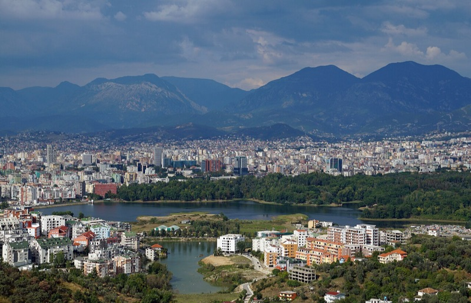

---
id    = "2f9b326c-1fb2-5eee-9392-a354a4e4cef6"
model = "Basic"
tags  = ["europe", "mediterranean", "sovereign_state", "capital"]
---

## Front

What is the capital of <b>Albania</b>?

## Back

<b>Tirana</b>

## Extra

<i>Photo: Albinfo, CC BY-SA 3.0, via Wikimedia Commons</i>

About 389,000 people (2023) Enclosed by mountains, with Dajti rising to the east

Founded in 1614 by the Ottoman Albanian nobleman Sylejman Pasha Bargjini around the Old Mosque. It stayed fairly unimportant until the Congress of Lushnjë proclaimed it Albania's capital after independence in 1912.

<a href="https://en.wikipedia.org/wiki/Tirana">Tirana on Wikipedia</a> <a href="https://en.wikipedia.org/wiki/Albania">Albania on Wikipedia</a>
