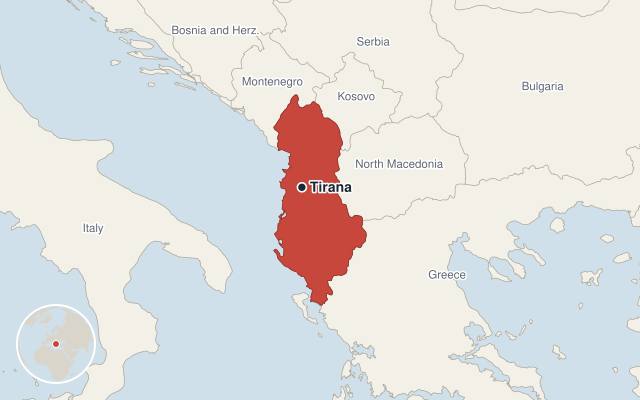

---
id    = "62fd8c57-b817-5269-9e01-0c657226b2e0"
model = "Basic"
tags  = ["europe", "mediterranean", "sovereign_state", "country"]
---

## Front

<b>Tirana</b> is the capital of which country or territory?

## Back

<b>Albania</b>

## Extra

About 2.8 million people (2023) in 28,748 km² Highest point: Korab

Albanians call their country Shqipëria, a name widely interpreted as "Land of the Eagles".

<a href="https://en.wikipedia.org/wiki/Albania">Albania on Wikipedia</a> <a href="https://en.wikipedia.org/wiki/Tirana">Tirana on Wikipedia</a>
