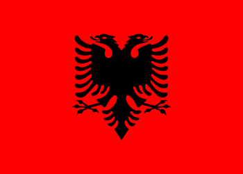
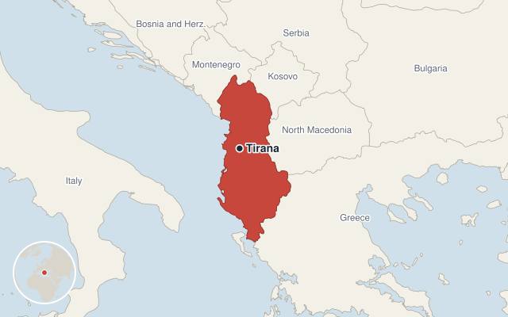

---
id    = "c0e7906b-4fa4-5eb6-bf9e-18ab1287a0c4"
model = "Basic"
tags  = ["europe", "mediterranean", "sovereign_state", "flag"]
---

## Front

Whose flag is this?

## Back

<b>Albania</b>

## Extra

Established as the national flag in 1912, at independence from the Ottoman Empire

Red stands for bravery, strength, valour and bloodshed. The black double-headed eagle comes from the Kastrioti coat of arms; a communist-era golden star was removed in 1992.

<a href="https://en.wikipedia.org/wiki/Flag_of_Albania">Flag of Albania on Wikipedia</a> <a href="https://en.wikipedia.org/wiki/Albania">Albania on Wikipedia</a>
