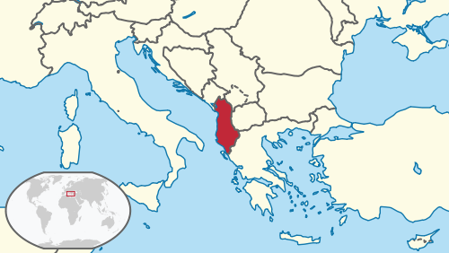

---
id    = "235b55a5-af1d-5a36-a4cc-f2ede51eb236"
model = "Basic"
tags  = ["europe", "mediterranean", "sovereign_state", "map"]
---

## Front

What is highlighted on this map?

## Back

<b>Albania</b>
