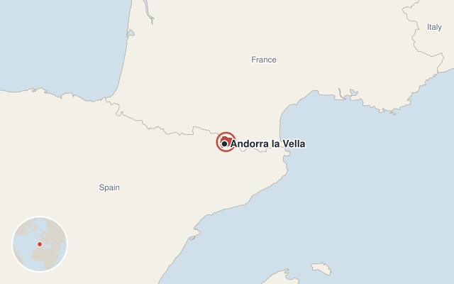
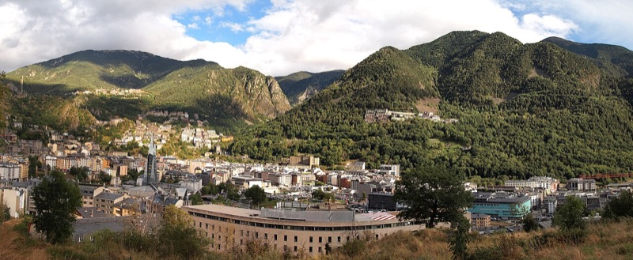

---
id    = "0cd53ad9-a198-5413-8152-37b1e0bcd4ee"
model = "Basic"
tags  = ["europe", "sovereign_state", "capital"]
---

## Front

What is the capital of <b>Andorra</b>?

## Back

<b>Andorra la Vella</b>

## Extra

<i>Photo: Tiia Monto, Tiia Monto, via Wikimedia Commons</i>

About 24,000 people (2023) 1,023 m up, the highest capital city in Europe

The name means "the city of Andorra"; vella here comes from the Latin villa, "city", not from the similar word for "old". The Casa de la Vall, built in the early 16th century, has been the parliament house since 1702.

<a href="https://en.wikipedia.org/wiki/Andorra_la_Vella">Andorra la Vella on Wikipedia</a> <a href="https://en.wikipedia.org/wiki/Andorra">Andorra on Wikipedia</a>
