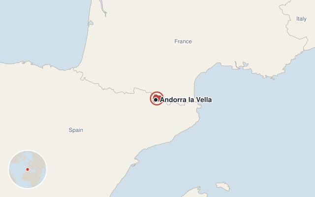

---
id    = "2d564ee4-995b-5f88-8317-ed394c1d7ab5"
model = "Basic"
tags  = ["europe", "sovereign_state", "country"]
---

## Front

<b>Andorra la Vella</b> is the capital of which country or territory?

## Back

<b>Andorra</b>

## Extra

About 90,000 people (2026) in 468 km² Sixth-smallest state in Europe

It has two co-princes: the Bishop of Urgell in Catalonia, Spain, and the president of France.

<a href="https://en.wikipedia.org/wiki/Andorra">Andorra on Wikipedia</a> <a href="https://en.wikipedia.org/wiki/Andorra_la_Vella">Andorra la Vella on Wikipedia</a>
