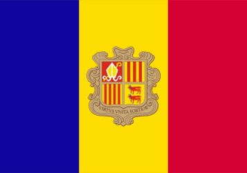
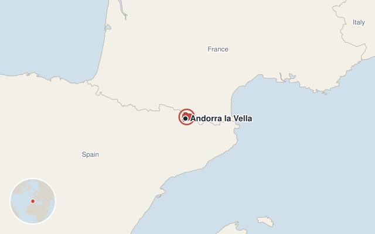

---
id    = "8c602c2e-7b26-5d5b-a37e-fd8bddca493f"
model = "Basic"
tags  = ["europe", "sovereign_state", "flag"]
---

## Front

Whose flag is this?

## Back

<b>Andorra</b>

## Extra

Similar flags: Moldova (wider, coat of arms with eagle)

<a href="https://en.wikipedia.org/wiki/Flag_of_Andorra">Flag of Andorra on Wikipedia</a> <a href="https://en.wikipedia.org/wiki/Andorra">Andorra on Wikipedia</a>
