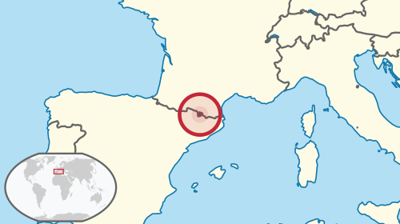
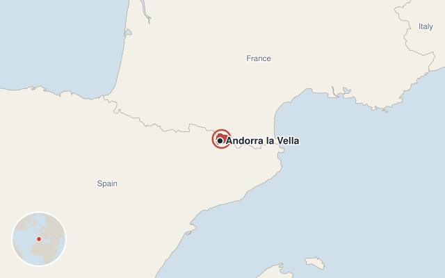

---
id    = "6d248ff5-c350-56ba-ad7b-c35dd36cb1cb"
model = "Basic"
tags  = ["europe", "sovereign_state", "map"]
---

## Front

What is highlighted on this map?

## Back

<b>Andorra</b>

## Extra

<a href="https://en.wikipedia.org/wiki/Andorra">Andorra on Wikipedia</a>
