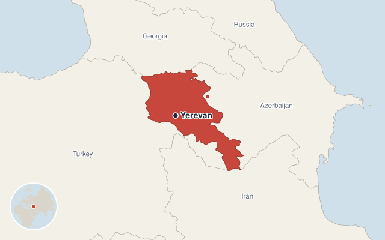
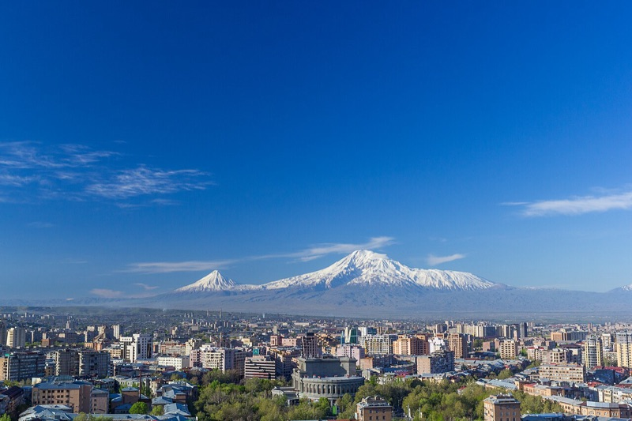

---
id    = "7c33a7e1-4ca7-530f-94ff-0926d11275cb"
model = "Basic"
tags  = ["europe", "sovereign_state", "capital"]
---

## Front

What is the capital of <b>Armenia</b>?

## Back

<b>Yerevan</b>

## Extra

<i>Photo: Սէրուժ Ուրիշեան (Serouj Ourishian), CC BY 4.0, via Wikimedia Commons</i>

About 1.1 million people (2024) 987 m up, on the Hrazdan River

It began in 782 BC as Erebuni, a fortress founded by King Argishti I of Urartu, which makes it one of the world's oldest continuously inhabited cities. It has been the capital since 1918.

<a href="https://en.wikipedia.org/wiki/Yerevan">Yerevan on Wikipedia</a> <a href="https://en.wikipedia.org/wiki/Armenia">Armenia on Wikipedia</a>
