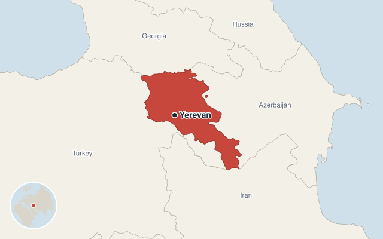

---
id    = "485a9359-b2e2-5e9b-b46b-eb040afc224b"
model = "Basic"
tags  = ["europe", "sovereign_state", "country"]
---

## Front

<b>Yerevan</b> is the capital of which country or territory?

## Back

<b>Armenia</b>

## Extra

About 2.9 million people (2017) in 29,743 km² Highest point: Mount Aragats

In AD 301 it became the first state in the world to adopt Christianity as its official religion.

<a href="https://en.wikipedia.org/wiki/Armenia">Armenia on Wikipedia</a> <a href="https://en.wikipedia.org/wiki/Yerevan">Yerevan on Wikipedia</a>
