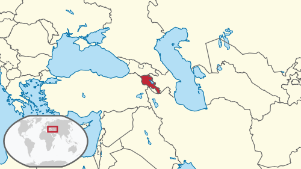
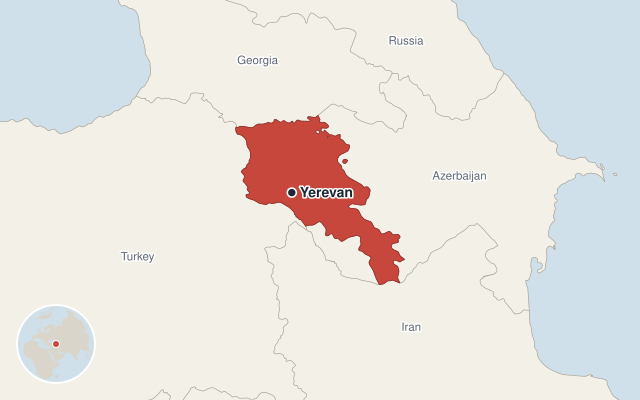
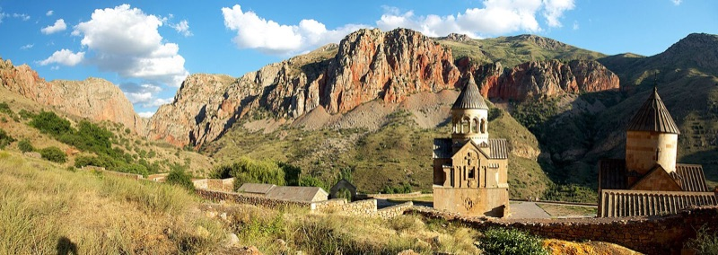

---
id    = "611b4f54-d778-5ac5-ad54-7b136704eaa2"
model = "Basic"
tags  = ["europe", "sovereign_state", "map"]
---

## Front

What is highlighted on this map?

## Back

<b>Armenia</b>

## Extra

<i>Photo: Alexander Naumov, CC BY 3.0, via Wikimedia Commons</i>

Borders Turkey, Georgia, Azerbaijan and Iran Landlocked, in the Armenian highlands

To the south it also touches Nakhchivan, an Azerbaijani exclave.

<a href="https://en.wikipedia.org/wiki/Armenia">Armenia on Wikipedia</a>
