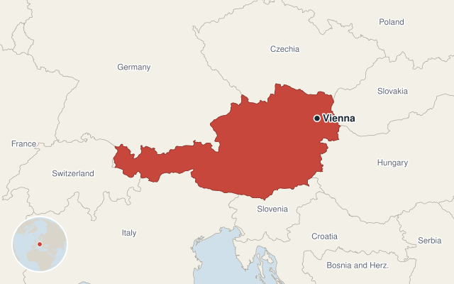
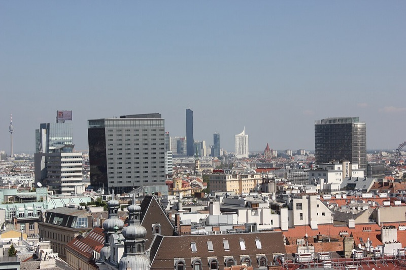

---
id    = "1112250f-9dda-57e2-9b2a-0ba51e42c57f"
model = "Basic"
tags  = ["europe", "european_union", "sovereign_state", "capital"]
---

## Front

What is the capital of <b>Austria</b>?

## Back

<b>Vienna</b>

## Extra

<i>Photo: Andrzej Otrębski, CC BY-SA 4.0, via Wikimedia Commons</i>

About 2 million people (2025), the most populous city on the Danube On the eastern edge of the Vienna Woods, the Alps' northeasternmost foothills

The Romans founded a camp here in the 1st century and called it Vindobona. From the 16th century the Habsburgs made it the seat of the Holy Roman emperors.

<a href="https://en.wikipedia.org/wiki/Vienna">Vienna on Wikipedia</a> <a href="https://en.wikipedia.org/wiki/Austria">Austria on Wikipedia</a>
