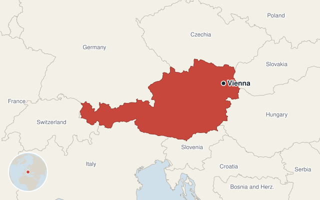

---
id    = "eb87ca2a-53db-576e-91a6-d2c371b967a6"
model = "Basic"
tags  = ["europe", "european_union", "sovereign_state", "country"]
---

## Front

<b>Vienna</b> is the capital of which country or territory?

## Back

<b>Austria</b>

## Extra

About 9 million people (2022) in about 84,000 km² Highest point: Grossglockner

The heartland of the Habsburg monarchy from the late 13th century. After Allied occupation it declared perpetual neutrality in 1955 and joined the European Union in 1995.

<a href="https://en.wikipedia.org/wiki/Austria">Austria on Wikipedia</a> <a href="https://en.wikipedia.org/wiki/Vienna">Vienna on Wikipedia</a>
