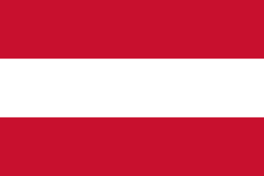

---
id    = "06cde190-baf6-51b6-ba25-7829a0ca101e"
model = "Basic"
tags  = ["europe", "european_union", "sovereign_state", "flag"]
---

## Front

Whose flag is this?

## Back

<b>Austria</b>

## Extra

Similar flags: Latvia (darker red, narrower white band)
