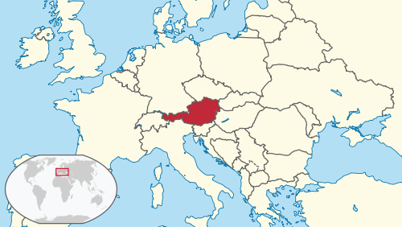

---
id    = "7f4c0caa-2e95-5d07-9c0f-3c60f02f5c6c"
model = "Basic"
tags  = ["europe", "european_union", "sovereign_state", "map"]
---

## Front

What is highlighted on this map?

## Back

<b>Austria</b>
