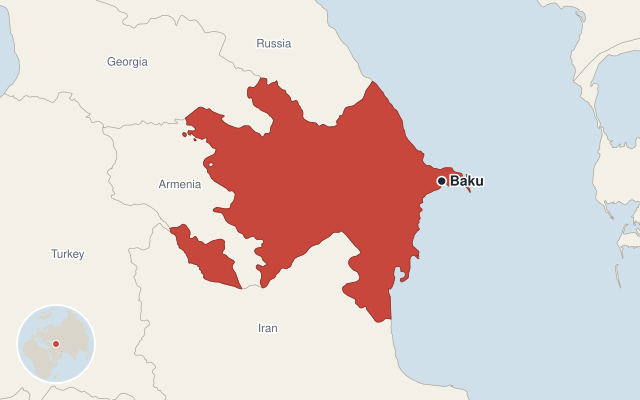

---
id    = "543b08da-ca5c-54e5-a7f3-4641e53a6e23"
model = "Basic"
tags  = ["europe", "sovereign_state", "capital"]
---

## Front

What is the capital of <b>Azerbaijan</b>?

## Back

<b>Baku</b>

## Extra

About 2.3 million people (2021) 28 m below sea level, the lowest-lying national capital in the world

Its nickname is the "City of Winds". The first oil well here was drilled in 1846, in the Bibi-Heybat suburb.

<a href="https://en.wikipedia.org/wiki/Baku">Baku on Wikipedia</a> <a href="https://en.wikipedia.org/wiki/Azerbaijan">Azerbaijan on Wikipedia</a>
