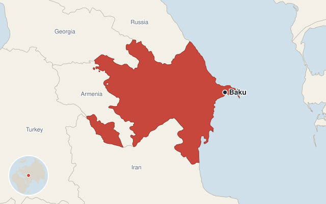

---
id    = "714bdef7-4b2b-55a7-8447-2f362db1e8bd"
model = "Basic"
tags  = ["europe", "sovereign_state", "country"]
---

## Front

<b>Baku</b> is the capital of which country or territory?

## Back

<b>Azerbaijan</b>

## Extra

About 10.2 million people (2023) in 86,600 km² Highest point: Mount Bazardüzü

Nearly half of all the mud volcanoes on Earth are concentrated here. Its 1918 republic was the first secular democratic Muslim-majority state in the world.

<a href="https://en.wikipedia.org/wiki/Azerbaijan">Azerbaijan on Wikipedia</a> <a href="https://en.wikipedia.org/wiki/Baku">Baku on Wikipedia</a>
