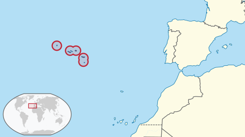

---
id    = "c0214077-dc07-5148-9e25-4e392121eb9b"
model = "Basic"
tags  = ["europe", "map"]
---

## Front

What is highlighted on this map?

## Back

<b>Azores</b>

## Extra

Nine volcanic islands, about 1,400 km west of mainland Portugal About 236,000 people (2021)

The islands run northwest to southeast for more than 600 km, in three groups. Mount Pico, the highest point in Portugal at 2,351 m, is on Pico island.

Autonomous region of Portugal.

<a href="https://en.wikipedia.org/wiki/Azores">Azores on Wikipedia</a>
