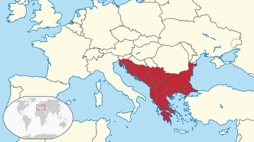

---
id    = "4212d476-79b8-5057-8071-4a0f9d4745fe"
model = "Basic"
tags  = ["europe", "map"]
---

## Front

What is highlighted on this map?

## Back

<b>Balkan Peninsula</b>

## Extra

<a href="https://en.wikipedia.org/wiki/Balkans">Balkans on Wikipedia</a>
