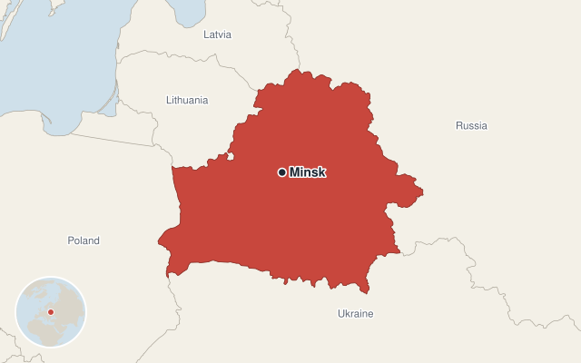

---
id    = "b5764a62-0f34-55be-b746-32546d1fee11"
model = "Basic"
tags  = ["europe", "sovereign_state", "capital"]
---

## Front

What is the capital of <b>Belarus</b>?

## Back

<b>Minsk</b>

## Extra

<a href="https://en.wikipedia.org/wiki/Minsk">Minsk on Wikipedia</a> <a href="https://en.wikipedia.org/wiki/Belarus">Belarus on Wikipedia</a>
