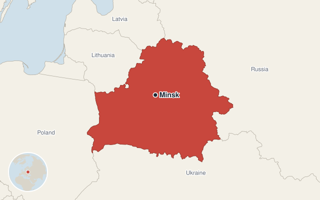

---
id    = "fdb23e1e-d70c-50ad-8780-11abcb6ac6af"
model = "Basic"
tags  = ["europe", "sovereign_state", "country"]
---

## Front

<b>Minsk</b> is the capital of which country or territory?

## Back

<b>Belarus</b>

## Extra

<a href="https://en.wikipedia.org/wiki/Belarus">Belarus on Wikipedia</a> <a href="https://en.wikipedia.org/wiki/Minsk">Minsk on Wikipedia</a>
