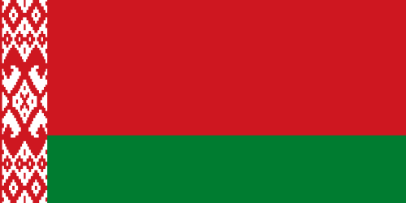
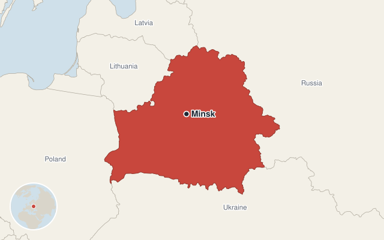

---
id    = "6fad7ee9-30c1-54ba-9cd5-6e9f241bd166"
model = "Basic"
tags  = ["europe", "sovereign_state", "flag"]
---

## Front

Whose flag is this?

## Back

<b>Belarus</b>

## Extra

Current design introduced in 2012, adapted from a 1995 referendum design

Adapted from the 1951 flag of the Soviet-era republic: the hammer and sickle and red star were removed, and the colours of the ornament pattern were reversed.

<a href="https://en.wikipedia.org/wiki/Flag_of_Belarus">Flag of Belarus on Wikipedia</a> <a href="https://en.wikipedia.org/wiki/Belarus">Belarus on Wikipedia</a>
