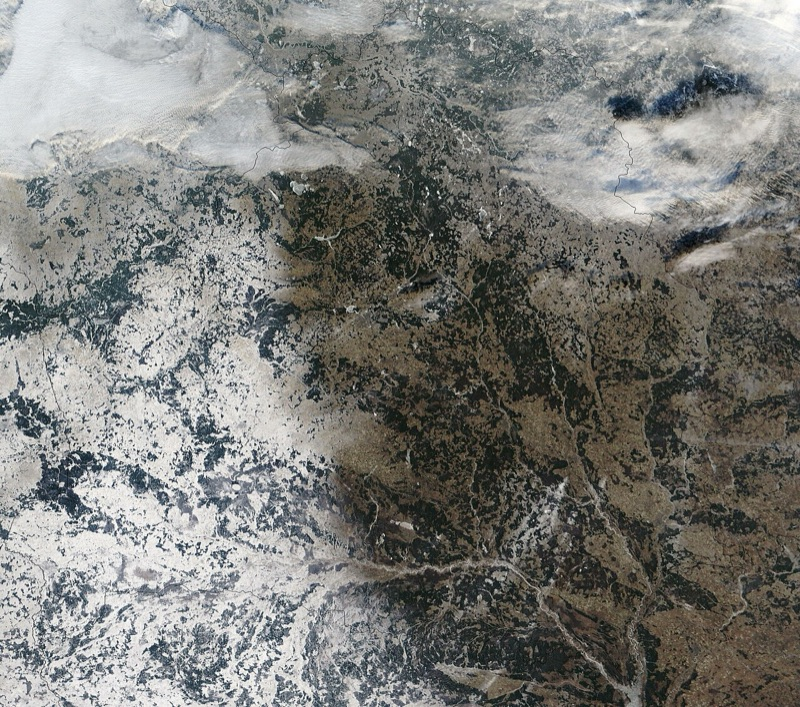

---
id    = "f45cbd36-22ee-536f-949a-2bf097c71915"
model = "Basic"
tags  = ["europe", "sovereign_state", "map"]
---

## Front

What is highlighted on this map?

## Back

<b>Belarus</b>

## Extra

<i>Photo: Unknown author, Public domain, via Wikimedia Commons</i>

Area about 207,600 km2 Highest point: Dziaržynkaja hara

Landlocked and relatively flat, stretching 560 km north to south and 650 km west to east. Large tracts are marshy, and the Pripyat flows east to the Dnieper.

<a href="https://en.wikipedia.org/wiki/Belarus">Belarus on Wikipedia</a>
