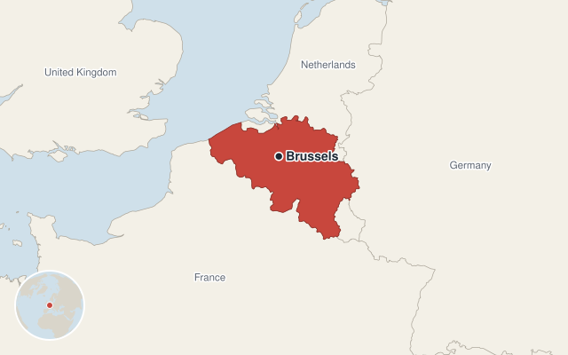
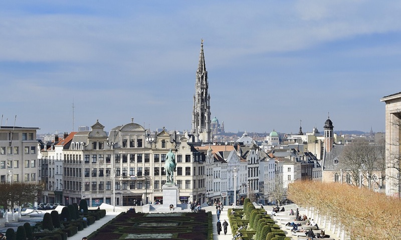

---
id    = "8989a761-5cd3-5c5b-8da6-eedf60158404"
model = "Basic"
tags  = ["europe", "european_union", "sovereign_state", "capital"]
---

## Front

What is the capital of <b>Belgium</b>?

## Back

<b>Brussels</b>

## Extra

<i>Photo: Ank Kumar, CC BY-SA 4.0, via Wikimedia Commons</i>

About 196,000 people in the City of Brussels (2024), 70 m above sea level Seat of principal European Union institutions, in its European Quarter

The City of Brussels is the historical centre of the Brussels-Capital Region. Like all municipalities in Brussels, it is officially bilingual in French and Dutch.

<a href="https://en.wikipedia.org/wiki/City_of_Brussels">City of Brussels on Wikipedia</a> <a href="https://en.wikipedia.org/wiki/Belgium">Belgium on Wikipedia</a>
