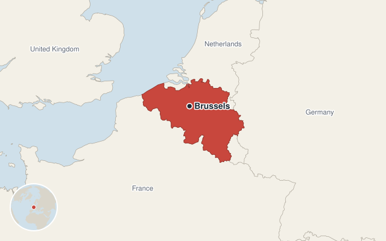

---
id    = "61a240c8-1c0a-5771-815c-746100cb6821"
model = "Basic"
tags  = ["europe", "european_union", "sovereign_state", "country"]
---

## Front

<b>Brussels</b> is the capital of which country or territory?

## Back

<b>Belgium</b>

## Extra

About 11.8 million people (2025) Three regions: Flanders, Wallonia and Brussels-Capital

Independent since the Belgian Revolution of 1830. After the 2010 federal election it went a record 589 days without a government formation.

<a href="https://en.wikipedia.org/wiki/Belgium">Belgium on Wikipedia</a> <a href="https://en.wikipedia.org/wiki/City_of_Brussels">City of Brussels on Wikipedia</a>
