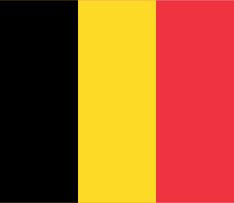
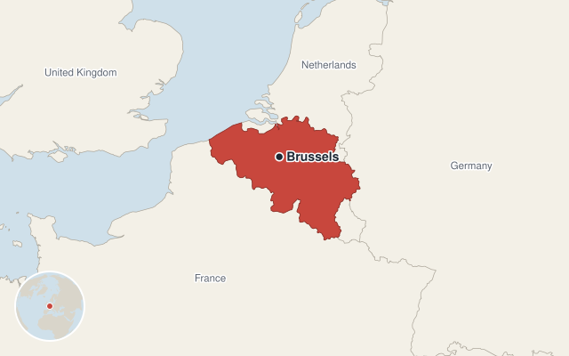

---
id    = "70dd0a22-d4c5-5bfe-8db0-5e26b412da6d"
model = "Basic"
tags  = ["europe", "european_union", "sovereign_state", "flag"]
---

## Front

Whose flag is this?

## Back

<b>Belgium</b>

## Extra

Enshrined in the Constitution on 23 January 1831

The colours come from the coat of arms of the Duchy of Brabant. Its proportions are 13:15, so unlike the flags of Switzerland and the Vatican City it is not a perfect square.

<a href="https://en.wikipedia.org/wiki/Flag_of_Belgium">Flag of Belgium on Wikipedia</a> <a href="https://en.wikipedia.org/wiki/Belgium">Belgium on Wikipedia</a>
