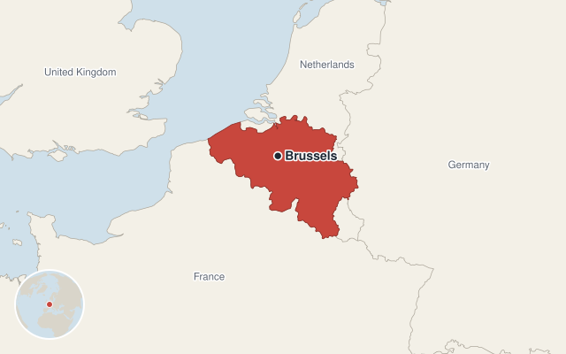
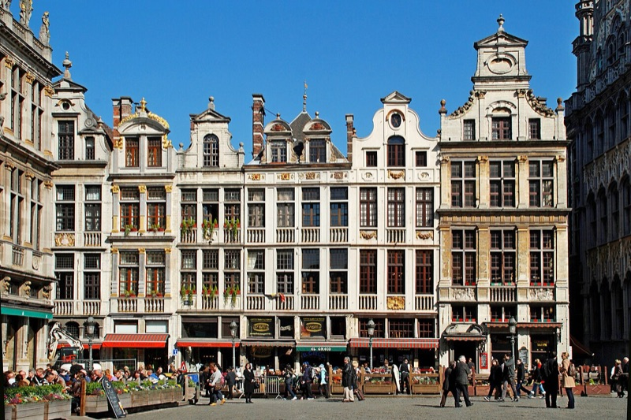

---
id    = "9e280d45-66f1-5a62-9c7c-2f666301b3dd"
model = "Basic"
tags  = ["europe", "european_union", "sovereign_state", "map"]
---

## Front

What is highlighted on this map?

## Back

<b>Belgium</b>

## Extra

<i>Photo: EmDee, CC BY-SA 3.0, via Wikimedia Commons</i>

Borders the Netherlands, Germany, Luxembourg and France About 30,700 km2, with the North Sea to the west

It lies in a coastal lowland region known as the Low Countries. The highest point, Signal de Botrange, is in the east.

<a href="https://en.wikipedia.org/wiki/Belgium">Belgium on Wikipedia</a>
