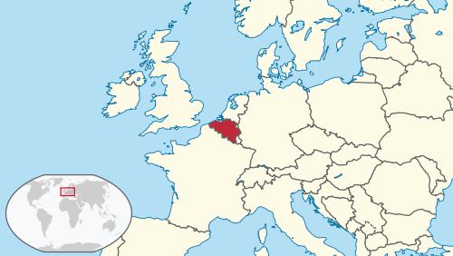

---
id    = "9e280d45-66f1-5a62-9c7c-2f666301b3dd"
model = "Basic"
tags  = ["europe", "european_union", "sovereign_state", "map"]
---

## Front

What is highlighted on this map?

## Back

<b>Belgium</b>
