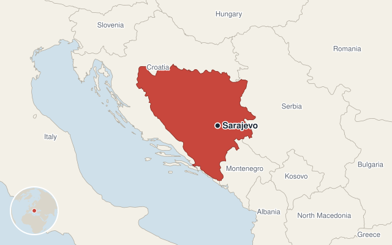

---
id    = "86cf0be7-d018-5cc6-8500-39033b12070a"
model = "Basic"
tags  = ["europe", "mediterranean", "sovereign_state", "capital"]
---

## Front

What is the capital of <b>Bosnia and Herzegovina</b>?

## Back

<b>Sarajevo</b>

## Extra

<a href="https://en.wikipedia.org/wiki/Sarajevo">Sarajevo on Wikipedia</a> <a href="https://en.wikipedia.org/wiki/Bosnia_and_Herzegovina">Bosnia and Herzegovina on Wikipedia</a>
