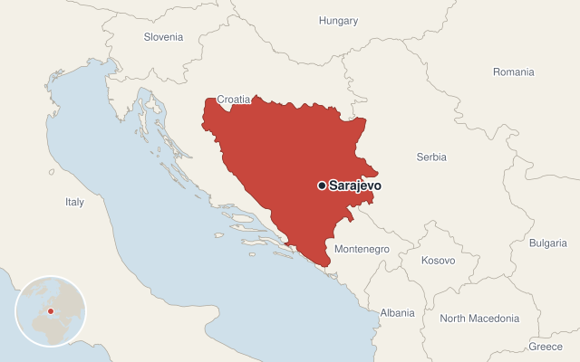
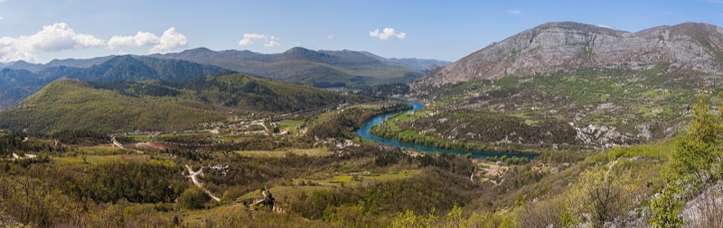

---
id    = "59c3562a-45d6-5f6b-8d25-5465ed509f68"
model = "Basic"
tags  = ["europe", "mediterranean", "sovereign_state", "country"]
---

## Front

<b>Sarajevo</b> is the capital of which country or territory?

## Back

<b>Bosnia and Herzegovina</b>

## Extra

<i>Photo: Diego Delso, Diego Delso, via Wikimedia Commons</i>

About 3.8 million people (2022) Highest point: Maglić

Herzegovina takes its name from the title of a 15th-century magnate, Stjepan Vukčić Kosača, who was Herceg (Herzog) of Hum and the Coast.

<a href="https://en.wikipedia.org/wiki/Bosnia_and_Herzegovina">Bosnia and Herzegovina on Wikipedia</a> <a href="https://en.wikipedia.org/wiki/Sarajevo">Sarajevo on Wikipedia</a>
