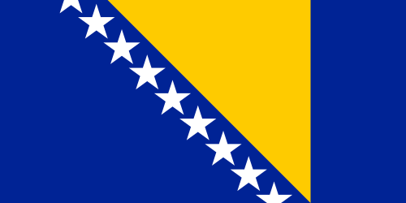
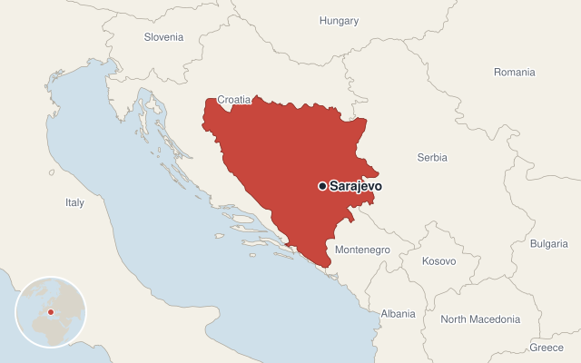

---
id    = "9668b6ff-73a8-56bc-93d4-acfb09ab32d2"
model = "Basic"
tags  = ["europe", "mediterranean", "sovereign_state", "flag"]
---

## Front

Whose flag is this?

## Back

<b>Bosnia and Herzegovina</b>

## Extra

<a href="https://en.wikipedia.org/wiki/Flag_of_Bosnia_and_Herzegovina">Flag of Bosnia and Herzegovina on Wikipedia</a> <a href="https://en.wikipedia.org/wiki/Bosnia_and_Herzegovina">Bosnia and Herzegovina on Wikipedia</a>
