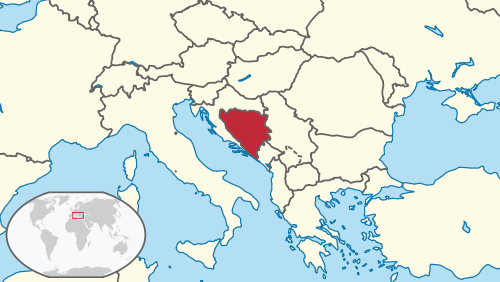
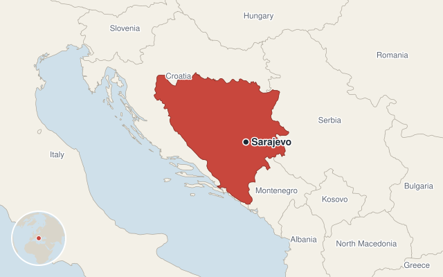

---
id    = "008119c9-b465-5bae-911e-16b3a890cd51"
model = "Basic"
tags  = ["europe", "mediterranean", "sovereign_state", "map"]
---

## Front

What is highlighted on this map?

## Back

<b>Bosnia and Herzegovina</b>

## Extra

<a href="https://en.wikipedia.org/wiki/Bosnia_and_Herzegovina">Bosnia and Herzegovina on Wikipedia</a>
