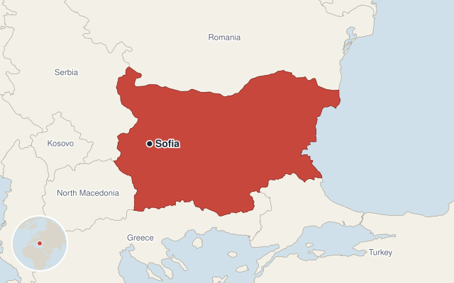

---
id    = "c53e85a9-62bf-53fe-9371-4725493a7246"
model = "Basic"
tags  = ["europe", "european_union", "sovereign_state", "capital"]
---

## Front

What is the capital of <b>Bulgaria</b>?

## Back

<b>Sofia</b>

## Extra

<a href="https://en.wikipedia.org/wiki/Sofia">Sofia on Wikipedia</a> <a href="https://en.wikipedia.org/wiki/Bulgaria">Bulgaria on Wikipedia</a>
