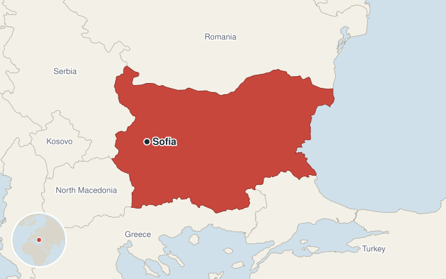

---
id    = "905d4af5-71c4-557b-beb0-f26be602937b"
model = "Basic"
tags  = ["europe", "european_union", "sovereign_state", "country"]
---

## Front

<b>Sofia</b> is the capital of which country or territory?

## Back

<b>Bulgaria</b>

## Extra

<a href="https://en.wikipedia.org/wiki/Bulgaria">Bulgaria on Wikipedia</a> <a href="https://en.wikipedia.org/wiki/Sofia">Sofia on Wikipedia</a>
