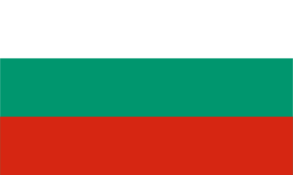
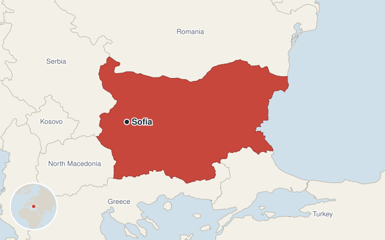

---
id    = "32eb647a-6096-528e-a87b-f1cd4201a8fb"
model = "Basic"
tags  = ["europe", "european_union", "sovereign_state", "flag"]
---

## Front

Whose flag is this?

## Back

<b>Bulgaria</b>

## Extra

Adopted after the 1877-1878 Russo-Turkish War, re-established in 1991

A tricolour of white, green and red horizontal bands. Under communist rule from 1947 a national emblem stood on the white stripe, and the current plain flag came back with the 1991 Constitution.

<a href="https://en.wikipedia.org/wiki/Flag_of_Bulgaria">Flag of Bulgaria on Wikipedia</a> <a href="https://en.wikipedia.org/wiki/Bulgaria">Bulgaria on Wikipedia</a>
