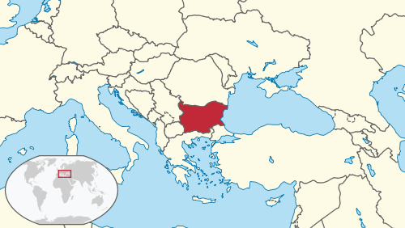
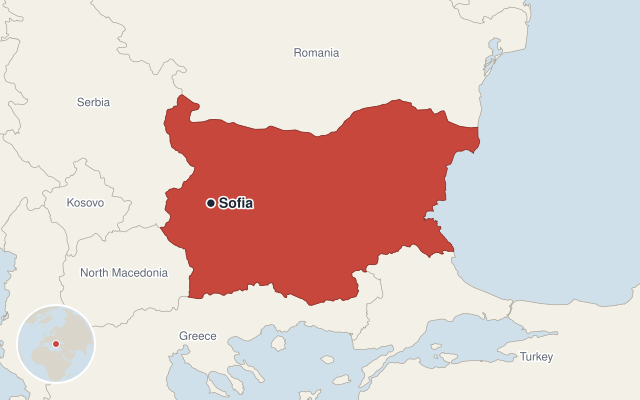
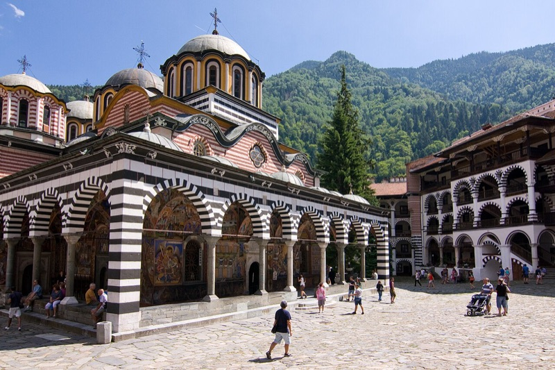

---
id    = "48e99624-b2e1-53f2-9621-ec479e8ef504"
model = "Basic"
tags  = ["europe", "european_union", "sovereign_state", "map"]
---

## Front

What is highlighted on this map?

## Back

<b>Bulgaria</b>

## Extra

<i>Photo: Raggatt2000, CC BY-SA 3.0, via Wikimedia Commons</i>

Borders Greece, Turkey, Serbia, North Macedonia and Romania The Danube forms the border with Romania, the Black Sea the east

The Balkan Mountains run from west to east through the middle of the country. Musala, in the Rila range, is the highest point in both Bulgaria and the Balkans.

<a href="https://en.wikipedia.org/wiki/Bulgaria">Bulgaria on Wikipedia</a>
