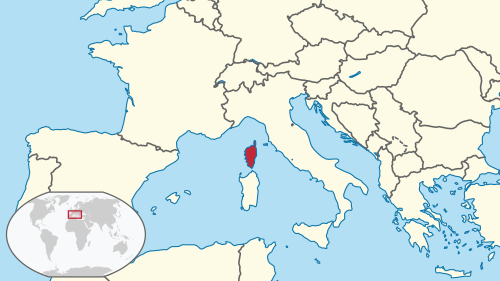

---
id    = "e3677703-51ff-5bd1-be61-4a1c402f4f10"
model = "Basic"
tags  = ["europe", "map"]
---

## Front

What is highlighted on this map?

## Back

<b>Corsica</b>

## Extra

Fourth-largest island in the Mediterranean, about 8,680 km2 About 355,000 people (2023)

A single chain of mountains makes up two-thirds of the island. Its nearest land is the Italian island of Sardinia, immediately to the south.

Region of France.

<a href="https://en.wikipedia.org/wiki/Corsica">Corsica on Wikipedia</a>
