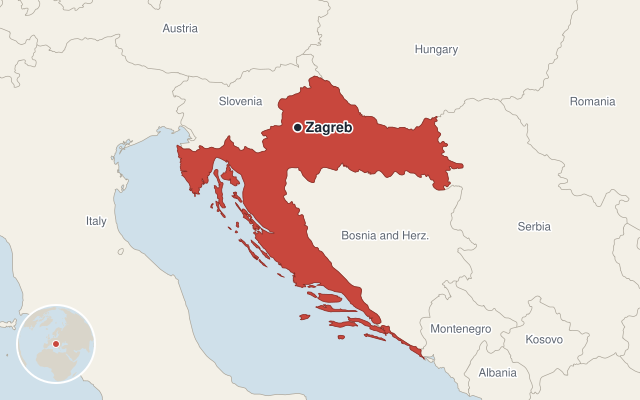

---
id    = "9fe78bbd-1645-577c-a220-0218fcdf5ab4"
model = "Basic"
tags  = ["europe", "european_union", "mediterranean", "sovereign_state", "capital"]
---

## Front

What is the capital of <b>Croatia</b>?

## Back

<b>Zagreb</b>

## Extra

<a href="https://en.wikipedia.org/wiki/Zagreb">Zagreb on Wikipedia</a> <a href="https://en.wikipedia.org/wiki/Croatia">Croatia on Wikipedia</a>
