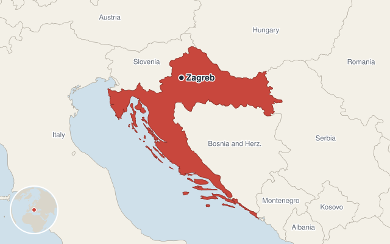

---
id    = "0e58db02-278d-58f2-9330-a8af1f1060d0"
model = "Basic"
tags  = ["europe", "european_union", "mediterranean", "sovereign_state", "country"]
---

## Front

<b>Zagreb</b> is the capital of which country or territory?

## Back

<b>Croatia</b>

## Extra

About 3.9 million people (2021) Highest point: Dinara

The Croatian coast has over 1,000 islands and islets in the Adriatic Sea. Tourism is a prominent part of its economy.

<a href="https://en.wikipedia.org/wiki/Croatia">Croatia on Wikipedia</a> <a href="https://en.wikipedia.org/wiki/Zagreb">Zagreb on Wikipedia</a>
