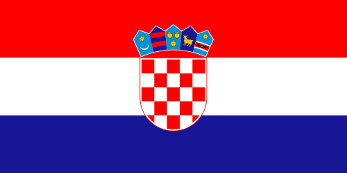
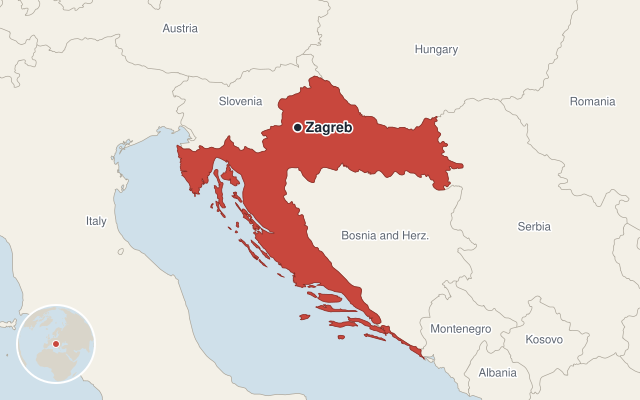

---
id    = "9f92929b-0e9d-51d8-937f-08346be6e395"
model = "Basic"
tags  = ["europe", "european_union", "mediterranean", "sovereign_state", "flag"]
---

## Front

Whose flag is this?

## Back

<b>Croatia</b>

## Extra

<a href="https://en.wikipedia.org/wiki/Flag_of_Croatia">Flag of Croatia on Wikipedia</a> <a href="https://en.wikipedia.org/wiki/Croatia">Croatia on Wikipedia</a>
