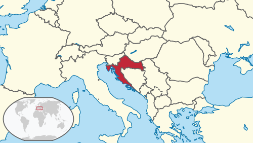
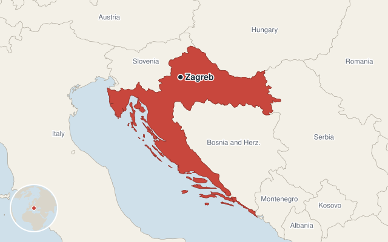

---
id    = "8f658fb7-aad6-5a05-a7e5-f745a7cd278d"
model = "Basic"
tags  = ["europe", "european_union", "mediterranean", "sovereign_state", "map"]
---

## Front

What is highlighted on this map?

## Back

<b>Croatia</b>

## Extra

<a href="https://en.wikipedia.org/wiki/Croatia">Croatia on Wikipedia</a>
