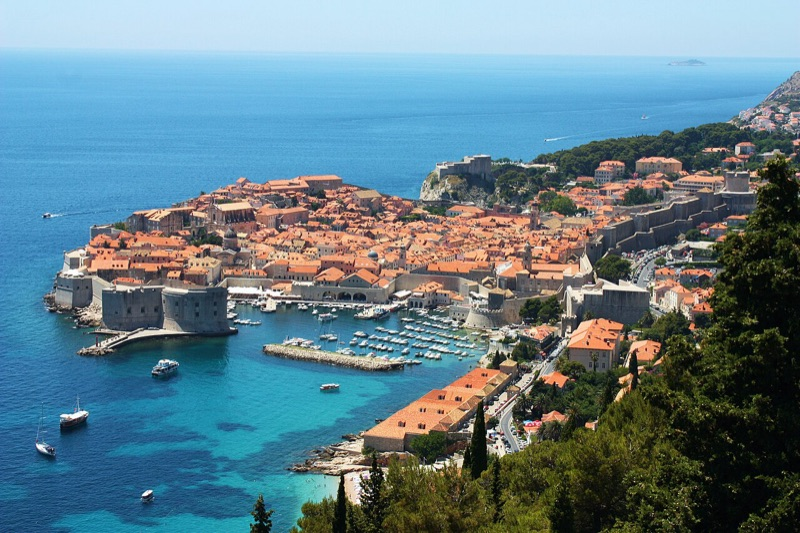

---
id    = "8f658fb7-aad6-5a05-a7e5-f745a7cd278d"
model = "Basic"
tags  = ["europe", "european_union", "mediterranean", "sovereign_state", "map"]
---

## Front

What is highlighted on this map?

## Back

<b>Croatia</b>

## Extra

<i>Photo: Bracodbk, CC BY-SA 3.0, via Wikimedia Commons</i>

Borders Slovenia, Hungary, Serbia, Bosnia and Herzegovina and Montenegro About 56,600 km2 along the Adriatic Sea

The Croatian archipelago contains over 1,000 islands and islets along the Adriatic coast. It shares a maritime border with Italy to the west.

<a href="https://en.wikipedia.org/wiki/Croatia">Croatia on Wikipedia</a>
