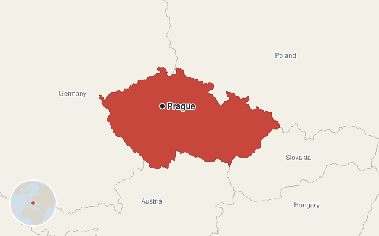

---
id    = "13cfdff3-921d-54aa-974a-1fe5a08d0002"
model = "Basic"
tags  = ["europe", "european_union", "sovereign_state", "capital"]
---

## Front

What is the capital of <b>Czech Republic</b>?

## Back

<b>Prague</b>

## Extra

Also known as Czechia.

<a href="https://en.wikipedia.org/wiki/Prague">Prague on Wikipedia</a> <a href="https://en.wikipedia.org/wiki/Czech_Republic">Czech Republic on Wikipedia</a>
