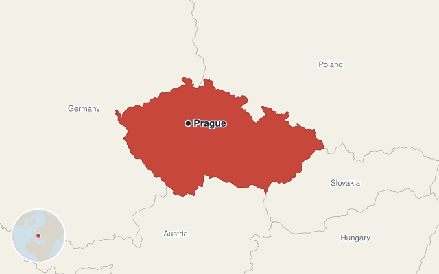

---
id    = "e4a553ca-562c-5941-a560-be78b41b7767"
model = "Basic"
tags  = ["europe", "european_union", "sovereign_state", "country"]
---

## Front

<b>Prague</b> is the capital of which country or territory?

## Back

<b>Czech Republic</b>

## Extra

About 10.9 million people (2025) Highest point: Sněžka

Also known as Czechia and historically as Bohemia, a name from Latin meaning "home of the Boii", a Gallic tribe.

Also known as Czechia.

<a href="https://en.wikipedia.org/wiki/Czech_Republic">Czech Republic on Wikipedia</a> <a href="https://en.wikipedia.org/wiki/Prague">Prague on Wikipedia</a>
