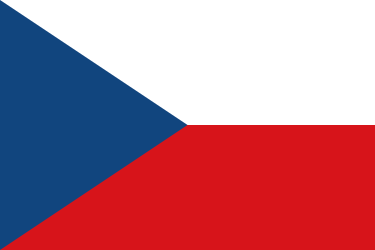
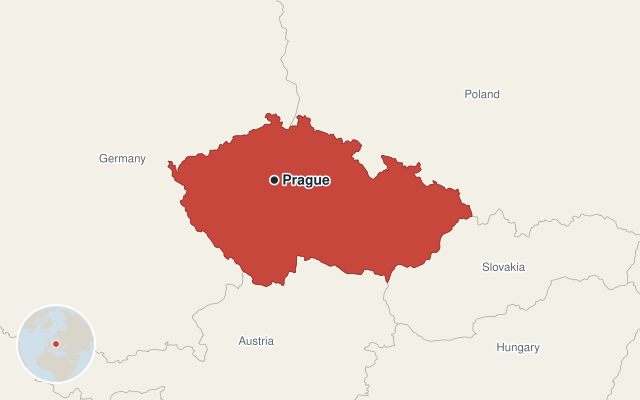

---
id    = "d34aab22-836e-5230-a706-9471334a63b1"
model = "Basic"
tags  = ["europe", "european_union", "sovereign_state", "flag"]
---

## Front

Whose flag is this?

## Back

<b>Czech Republic</b>

## Extra

Also known as Czechia.

<a href="https://en.wikipedia.org/wiki/Flag_of_the_Czech_Republic">Flag of the Czech Republic on Wikipedia</a> <a href="https://en.wikipedia.org/wiki/Czech_Republic">Czech Republic on Wikipedia</a>
