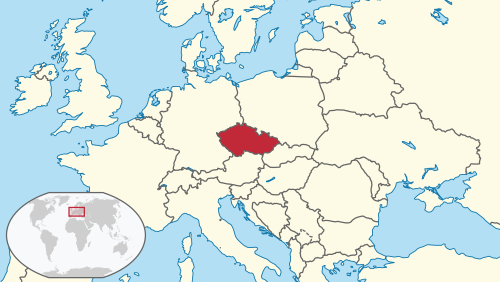

---
id    = "5cb0e62e-aead-5abb-88c2-43a4d72a3d8a"
model = "Basic"
tags  = ["europe", "european_union", "sovereign_state", "map"]
---

## Front

What is highlighted on this map?

## Back

<b>Czech Republic</b>

## Extra

Also known as Czechia.
