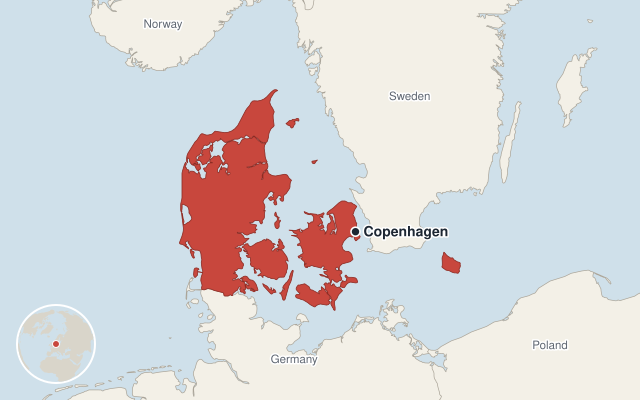

---
id    = "2a9939cf-4d39-51cb-a503-320706f3b1d6"
model = "Basic"
tags  = ["europe", "european_union", "sovereign_state", "capital"]
---

## Front

What is the capital of <b>Denmark</b>?

## Back

<b>Copenhagen</b>

## Extra

About 667,000 people (2025) On the islands of Zealand and Amager, across the Øresund strait from Malmö

A Viking fishing village in the 10th century, it became the capital in the early 15th century. Its Danish name, København, reflects its origin as a harbour and a place of commerce.

<a href="https://en.wikipedia.org/wiki/Copenhagen">Copenhagen on Wikipedia</a> <a href="https://en.wikipedia.org/wiki/Denmark">Denmark on Wikipedia</a>
