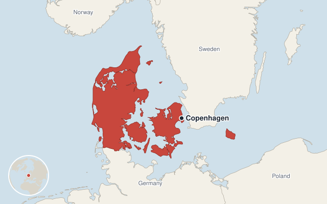

---
id    = "464cd9da-0f46-558a-96e2-6fdb121707b6"
model = "Basic"
tags  = ["europe", "european_union", "sovereign_state", "country"]
---

## Front

<b>Copenhagen</b> is the capital of which country or territory?

## Back

<b>Denmark</b>

## Extra

About 5.8 million people (2020) Highest point: Møllehøj

Part of the Kingdom of Denmark, which also includes the autonomous Faroe Islands and Greenland. Mostly flat, arable land with sandy coasts and low elevation.

<a href="https://en.wikipedia.org/wiki/Denmark">Denmark on Wikipedia</a> <a href="https://en.wikipedia.org/wiki/Copenhagen">Copenhagen on Wikipedia</a>
