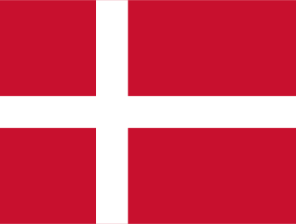
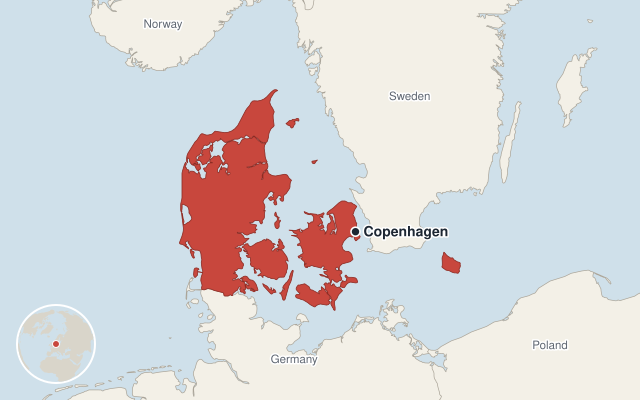

---
id    = "1515d11b-7e5f-5cb3-8acc-a2c4e602aef5"
model = "Basic"
tags  = ["europe", "european_union", "sovereign_state", "flag"]
---

## Front

Whose flag is this?

## Back

<b>Denmark</b>

## Extra

The 1748 regulation defining it is still in force

Called the Dannebrog, literally "red cloth". It holds the Guinness world record as the oldest continuously used national flag, since 1625. The elongated Nordic cross represents Christianity.

<a href="https://en.wikipedia.org/wiki/Dannebrog">Dannebrog on Wikipedia</a> <a href="https://en.wikipedia.org/wiki/Denmark">Denmark on Wikipedia</a>
