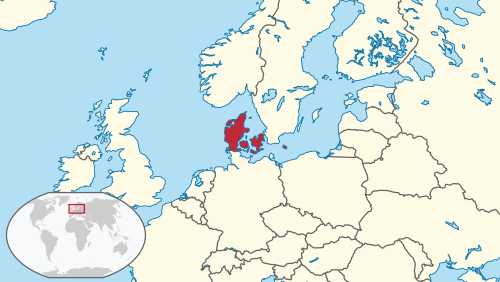
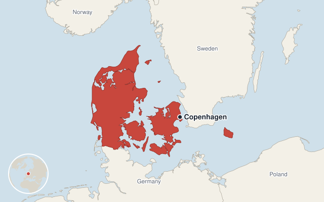

---
id    = "05630caa-6314-5074-9108-b01f467f21af"
model = "Basic"
tags  = ["europe", "european_union", "sovereign_state", "map"]
---

## Front

What is highlighted on this map?

## Back

<b>Denmark</b>

## Extra

<a href="https://en.wikipedia.org/wiki/Denmark">Denmark on Wikipedia</a>
